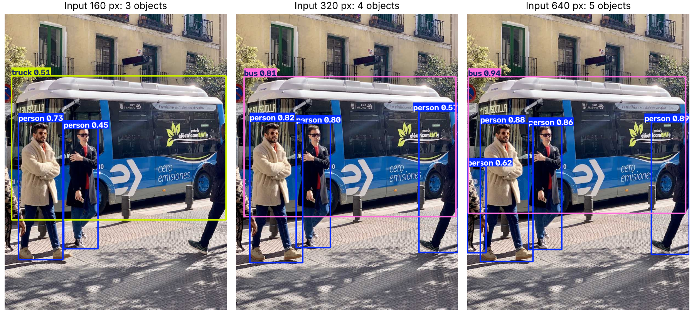
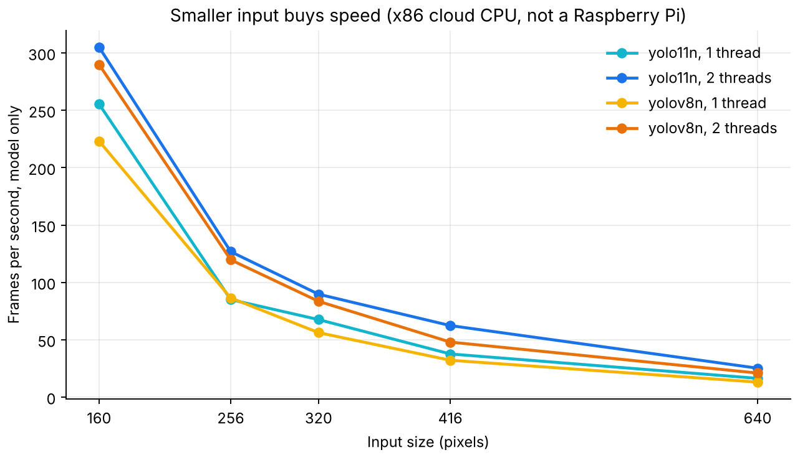
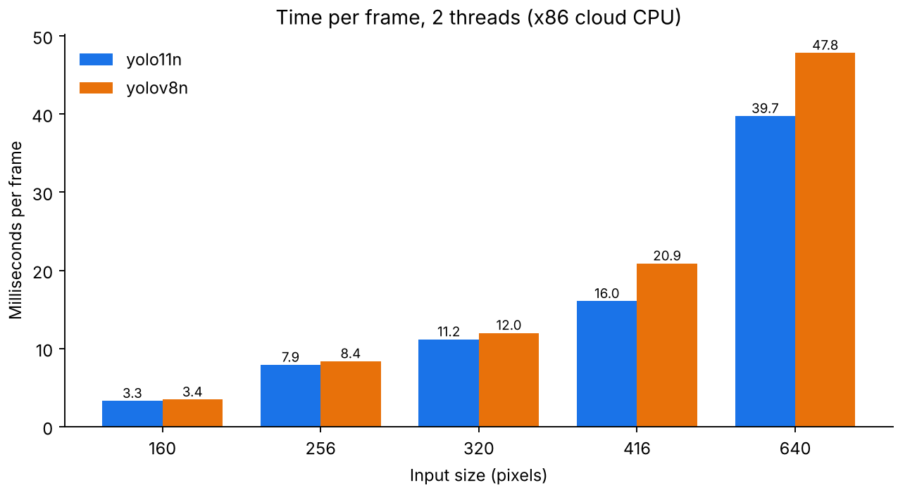
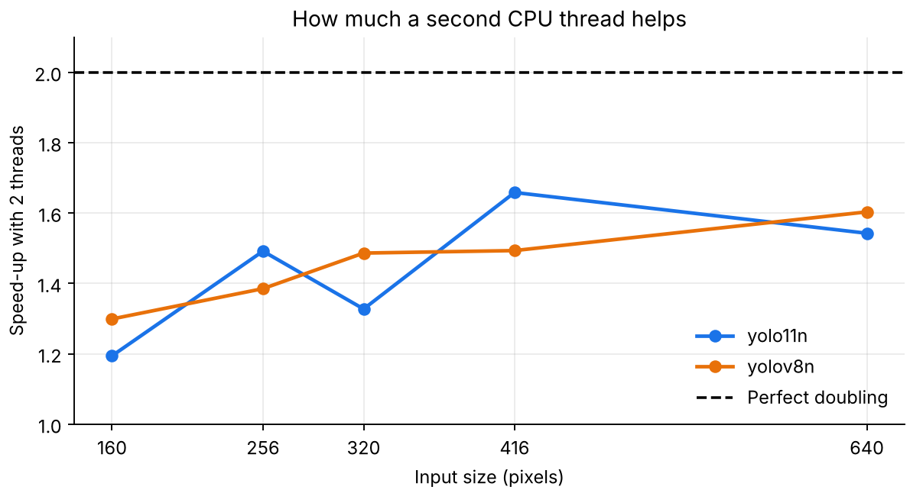
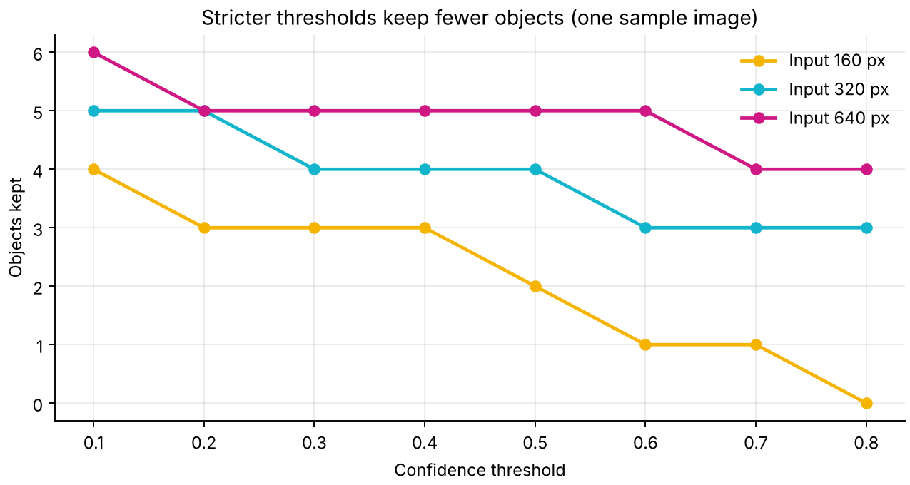
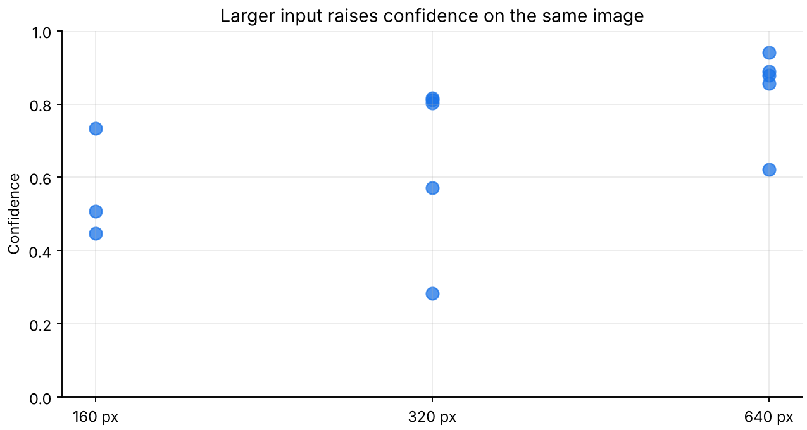
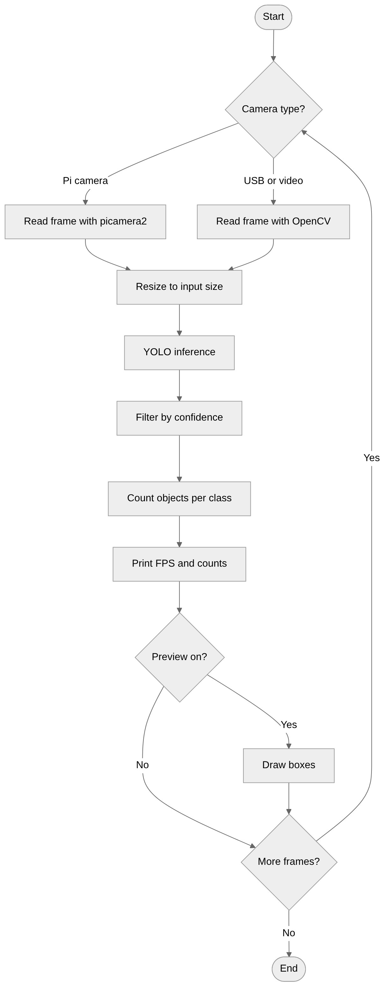

# Raspberry Pi YOLO Object Detection

**Live object detection script for a Raspberry Pi camera or webcam, with a benchmark that shows which input size to choose.** Run the benchmark once on your own board and pick the fastest setting that still sees what you need.



## Key results

Measured on an x86 cloud CPU (Intel Xeon 2.10 GHz) with ONNX Runtime, **not on a Raspberry Pi**. Expect a Pi to be slower, so use the trends and measure your own speed.

| Model | Input | Time, 2 threads | FPS, model only | ONNX size |
|---|---:|---:|---:|---:|
| YOLO11n | 160 | 3.3 ms | 305 | 10.5 MB |
| YOLO11n | 256 | 7.9 ms | 127 | 10.6 MB |
| YOLO11n | 320 | 11.2 ms | 90 | 10.6 MB |
| YOLO11n | 416 | 16.0 ms | 62 | 10.6 MB |
| YOLO11n | 640 | 39.7 ms | 25 | 10.7 MB |
| YOLOv8n | 640 | 47.8 ms | 21 | 12.8 MB |

What this shows:

- Going from 640 to 320 pixels makes YOLO11n about **3.6 times faster**.
- The price is detection. On the sample image it finds 5 objects at 640, 4 at 320 and 3 at 160.
- YOLO11n was faster than YOLOv8n in 9 of the 10 settings tested, and its file is smaller.



| Time per frame | Second CPU thread |
|---|---|
|  |  |

| Confidence threshold | Confidence by input size |
|---|---|
|  |  |

More findings:

- A second thread gave a 1.2 to 1.7 times speed-up, not double.
- At a strict 0.8 threshold, 640 pixels keeps 4 objects, 320 keeps 3 and 160 keeps none.
- The top confidence on the sample image rises from 0.73 at 160 pixels to 0.94 at 640 pixels.

## Flowchart

<p align="center"></p>

## Run it

```bash
pip install -r requirements.txt

python benchmark.py                          # speed table for this machine
python plot_results.py                       # charts

python detect_camera.py --source 0           # USB webcam
python detect_camera.py --picamera --size 256   # Raspberry Pi camera
python detect_camera.py --source video.mp4 --show
```

On Raspberry Pi OS, install `picamera2` with `sudo apt install python3-picamera2`. Weights download on first run.

## Limits

- **Neither script has been run on a Raspberry Pi yet.** Speeds above are from a cloud CPU and cover model time only, with no camera or display.
- The object counts come from one sample image, so they do not measure accuracy.
- Models detect the 80 COCO classes.

## License

This project uses [Ultralytics YOLO](https://github.com/ultralytics/ultralytics), which is AGPL-3.0, and the sample image comes from that project. Check that license before using this in a closed product.

## Author

Jaafar Salim, University of Technology, Iraq

Topics: Raspberry Pi, YOLO, object detection, edge AI, computer vision, ONNX, Python.
